# mario-rl: reinforcement learning agents for all of Super Mario Bros.

This started as a Stanford CS221 project (Dec 2017): Deep Q-Learning that learned to play level 1-1. The 2026
rewrite ports it to a modern stack and pursues two goals:

- **Goal A: clear the whole game.** One agent trained on all 32 levels.
- **Goal B: play levels it has never seen.** Train on 22 levels and test on 7 held-out ones, both from a cold start
  and after brief practice.

| goal | best result so far | run |
|---|---|---|
| A, all 32 levels | **77.2%** greedy completion; 30 of 32 levels cleared at least once, including the maze castle 7-4 | E40b |
| A, 29 non-maze levels | **87.2%** greedy completion (27 of 29 levels at ≥ 50%) | E25 @180M |
| B, unseen levels, cold start | **30.2 ± 1.2%** progress (vs 21.5 ± 1.0 for a full-screen view) | E21, 2/8 window |
| B, unseen levels, brief practice | 40.5% progress after 25k steps of fine-tuning, 2.5x a policy trained from scratch | E30 |

Every experiment (E1-E43) is logged with its hypothesis, pre-registered success criteria and outcome in
[`results/EXPERIMENTS.md`](results/EXPERIMENTS.md). The original 2017 code is kept in [`legacy/`](legacy/README.md).

## Level clears

One clear of every level, recorded from the level start. **30 of 32 are played by a single agent** (E43 seed 2, greedy actions;
the first episode for 28 levels, a later one for 7-2 and 7-3). No agent clears **4-4 and 8-4** yet, so those two show the route found by
the scripted search (E42), replayed from the level start; that is not the agent playing. Click a preview for the full-size video
(MP4, real time). The clips are regenerated with `scripts/record_clears.py`, and `results/videos/manifest.json` records which run and
episode produced each one.

| | | | |
|---|---|---|---|
| <a href="results/videos/1-1.mp4">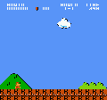</a><br>1-1 · agent | <a href="results/videos/1-2.mp4">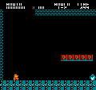</a><br>1-2 · agent | <a href="results/videos/1-3.mp4">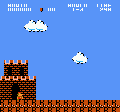</a><br>1-3 · agent | <a href="results/videos/1-4.mp4"></a><br>1-4 · agent |
| <a href="results/videos/2-1.mp4">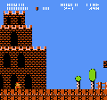</a><br>2-1 · agent | <a href="results/videos/2-2.mp4">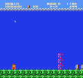</a><br>2-2 · agent | <a href="results/videos/2-3.mp4">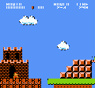</a><br>2-3 · agent | <a href="results/videos/2-4.mp4">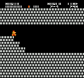</a><br>2-4 · agent |
| <a href="results/videos/3-1.mp4">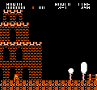</a><br>3-1 · agent | <a href="results/videos/3-2.mp4">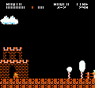</a><br>3-2 · agent | <a href="results/videos/3-3.mp4">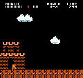</a><br>3-3 · agent | <a href="results/videos/3-4.mp4"></a><br>3-4 · agent |
| <a href="results/videos/4-1.mp4"></a><br>4-1 · agent | <a href="results/videos/4-2.mp4">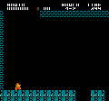</a><br>4-2 · agent | <a href="results/videos/4-3.mp4">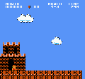</a><br>4-3 · agent | <a href="results/videos/4-4.mp4">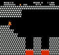</a><br>4-4 · **search route** |
| <a href="results/videos/5-1.mp4">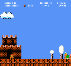</a><br>5-1 · agent | <a href="results/videos/5-2.mp4">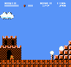</a><br>5-2 · agent | <a href="results/videos/5-3.mp4">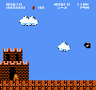</a><br>5-3 · agent | <a href="results/videos/5-4.mp4"></a><br>5-4 · agent |
| <a href="results/videos/6-1.mp4">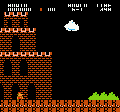</a><br>6-1 · agent | <a href="results/videos/6-2.mp4">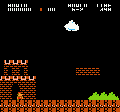</a><br>6-2 · agent | <a href="results/videos/6-3.mp4">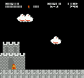</a><br>6-3 · agent | <a href="results/videos/6-4.mp4">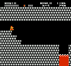</a><br>6-4 · agent |
| <a href="results/videos/7-1.mp4">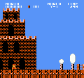</a><br>7-1 · agent | <a href="results/videos/7-2.mp4"></a><br>7-2 · agent | <a href="results/videos/7-3.mp4">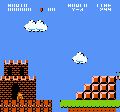</a><br>7-3 · agent | <a href="results/videos/7-4.mp4"></a><br>7-4 · agent |
| <a href="results/videos/8-1.mp4">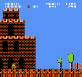</a><br>8-1 · agent | <a href="results/videos/8-2.mp4">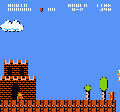</a><br>8-2 · agent | <a href="results/videos/8-3.mp4">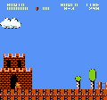</a><br>8-3 · agent | <a href="results/videos/8-4.mp4">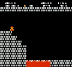</a><br>8-4 · **search route** |

## Quick start

```bash
uv venv -p 3.11 && source .venv/bin/activate
uv pip install -e ".[dev,tensorboard,plot]"   # pulls CPU-only torch wheels (see pyproject)
# with an NVIDIA GPU, swap in a CUDA build of torch:
uv pip install --reinstall-package torch torch --index-url https://download.pytorch.org/whl/cu130
```

With a GPU present, the PPO update and action selection run on it automatically (`--device auto`, `--inference auto`).
Without uv: `pip install torch --index-url https://download.pytorch.org/whl/cpu && pip install -e ".[dev]"`.

**Recipes**

```bash
# Goal B: transfer to unseen levels (22 training levels; evaluates on the 7 held-out ones)
mario-rl train --ego-back 2 --ego-ahead 8 --total-steps 10000000 --num-envs 8 --num-steps 256 --eval-interval 500000

# Goal A: the whole game (E40b's settings; plan on 100M+ steps)
mario-rl train --levels all --actions simple_down --ego-back 4 --ego-ahead 12 --level-sampler completion \
  --mid-start-prob 0.5 --mid-start-levels 2-2,7-2,4-4,7-4,8-4 --total-steps 200000000 --num-envs 8 --num-steps 256 \
  --eval-levels all --no-eval-on-train --eval-interval 10000000 --save-interval 10000000

mario-rl eval runs/<run>/latest.pt --levels test train --episodes 10 [--greedy]   # per-level report
mario-rl play runs/<run>/latest.pt --level 2-1 --output play.gif                    # watch an episode
mario-rl plot runs/<run>                                                            # training curves
scripts/fewshot.sh OUT "runs/<run>-seedSEED/latest.pt" "--obs tiles2 --ego-back 2 --ego-ahead 8" 1
                                                    # few-shot score: fine-tune on each held-out level, 25k-100k steps
```

`mario-rl train --help` lists every option; they map 1:1 onto `EnvConfig` and `PPOConfig`. `--resume` continues a run,
and `--init-from` starts a new run from another run's weights.

Using the environment directly:

```python
import gymnasium as gym
import mario_rl  # registers the env

env = gym.make("MarioRL/SuperMarioBros-v0", levels=("1-1", "2-1"))  # obs="tiles2" by default
obs, info = env.reset(seed=0)                   # obs["grid"]: (4, 26, 32) uint8, obs["vec"]: (10,)
obs, reward, terminated, truncated, info = env.step(env.action_space.sample())
env.reset(options={"level": "8-1"})             # force any level
```

stable-retro runs **one emulator per process**. Close an env before creating another one in the same process, and use
separate processes to run several at once (the trainer does this for you).

## How it works

### Environment (`env.py`, `smb.py`, `tiles.py`, `objects.py`)

A [Gymnasium](https://gymnasium.farama.org/) env over all 32 levels on the FCEUmm core from
[stable-retro](https://github.com/Farama-Foundation/stable-retro). It has no `gym` / `nes-py` dependency and is NumPy 2 compatible.

| | |
|---|---|
| Level select | boot the ROM, write world/stage/area into RAM on the title screen, keep an in-memory save state per level (all 32 boot in ~1.5 s) |
| Step | frame skip 4, frame stack 4; pipe / vine / area-change cut-scenes are fast-forwarded |
| Start | 0-30 random idle frames, so enemy timing varies between episodes |
| Actions | `simple` (default, 7: NOOP, right, right+A, right+B, right+A+B, A, left), `simple_down` (+ DOWN, for the 8-4 pipes), `right_only`, `complex` |
| Reward | `0.1 × (Δx − clock ticks − 25·death + 50·flag)`; Δx ignores teleports (pipes, sub-areas) |
| Episode end | terminated on death or the flag / castle axe; truncated after 3000 steps or 250 steps without new progress |
| Info | `level`, `x_pos`, `max_x`, `progress` (fraction of the level; 1.0 at the flag), `flag_get`, `trial_end`, and an `episode` summary |

Several rules were added after tracing levels the agent could not clear. All are on by default:

| rule | why |
|---|---|
| `block_ceiling_route` | in 1-2 / 4-2, running on top of the ceiling past the exit pipe leads into a dead-end warp zone. Progress above the screen earns nothing there, and staying up ends the episode like a death |
| `swim_tap` | swim strokes need a new A press; with the 4-frame repeat, holding A gave one stroke and Mario sank. A is released on the last frame of each step while swimming |
| `maze_new_ground_reward` | in the maze castles (4-4, 7-4, 8-4) a wrong path teleports Mario back; progress only counts new ground in each area, so loops pay nothing |
| `maze_loop_penalty` | each such loop costs as much as a death, so the looping branch is punished |
| signed `x_pos` | stepping left of a level start used to underflow the page byte (x ≈ 65533) |

### Observations

| `--obs` | what the network sees |
|---|---|
| **`tiles2`** (default) | `grid` (4, 26, 32): 8 px cells of `empty, solid, stompable, hazard, platform, mario`. Terrain comes from the game's block buffer (`$0500`), enemies / lifts / Mario from the collision boxes it computes every frame, and firebar segments and hammers (Hammer Bros and Bowser) from the sprite table. `vec` (10): Mario's x/y speed, ground / jump / fall / climb state, size, fire, swimming, star |
| `tiles2` + `--ego-back B --ego-ahead A` | the grid cropped to a window from B cells behind to A cells ahead of Mario. 2/8 transfers best to unseen levels; 4/12 sees far enough ahead to clear levels |
| `objects` | a Mario-relative terrain profile (pit flag + the 3 nearest surfaces per 16 px column) and the 12 nearest entities (class, relative position, size, level-frame velocity), with a permutation-invariant set encoder |
| `tiles`, `pixels` | the 2017-style 13x16 grid, and 84x84 grayscale frames |

Optional extra `vec` inputs: `--position-features` adds x, area and the game's maze counters (`$06D9` correct / `$06DA` passed
checkpoints), and trial mode (below) adds the previous action, the previous reward, a first-step flag and the attempt index.

### Levels (`levels.py`)

| split | levels |
|---|---|
| train (22) | 1-1 1-2 1-3 1-4 2-2 2-3 2-4 3-1 3-2 3-4 4-1 4-3 5-2 5-3 5-4 6-1 6-3 7-2 7-3 8-1 8-2 8-3 |
| held-out test (7) | 2-1 3-3 4-2 5-1 6-2 6-4 7-1 (overworld, athletic, underground, castle) |
| maze castles (3) | 4-4 7-4 8-4: they loop until the right path is taken (part of `all`, not of `train` / `test`) |

Presets for `--levels` / `--eval-levels`: `train`, `test`, `all`, `no-maze`, `world1`, or a list such as `1-1,1-2`.
SMB reuses some layouts (6-4 is close to 1-4, 7-3 to 2-3), so a few held-out levels have relatives in the training set.

### Agent and training (`ppo.py`, `models.py`, `workers.py`, `inference.py`, `plr.py`, `recurrent.py`)

- **PPO** with GAE(γ=0.99, λ=0.95), separate actor and critic encoders (a shared trunk let the value loss swamp the policy),
  reward normalization, linear LR annealing, per-network gradient clipping, and bootstrapping on time-limit truncation.
- **Level sampling**: `uniform`, `plr` (Prioritized Level Replay), or `completion` (weight 0.2 + (1 − running completion
  rate), so unsolved levels get up to 6x the practice). `--mid-start-prob` starts some training episodes from archived
  mid-level states (`--mid-start-levels` limits it to some levels; `--mid-start-y-bands` keeps one state per height band).
  Evaluation always starts at the level start.
- **Studied options**: DrAC shift augmentation (`--aug-shift`), an IMPALA encoder (`--arch impala`), procedural terrain
  noise (`--terrain-noise`), an auxiliary forward model (`--aux-coef`), Reptile meta-learning (`--meta-inner-steps`),
  and RL²: trials of several attempts at one level (`--trial-episodes`) with a recurrent GRU policy (`--recurrent`).
- **Throughput**: each worker process owns one emulator (~3000 frames/s per core). Without a GPU, workers act with a
  shared-memory copy of the policy and return a whole rollout in one message (~650 env steps/s on a 4-vCPU VM). With a
  GPU, the learner picks actions for whichever workers are ready (asynchronous dynamic batching) by replaying a CUDA graph
  per batch size. That gives ~3650 env steps/s with 8 envs on a Ryzen 3900X + RTX 4080 (vs ~990 with a CPU learner), and
  three runs side by side reach ~7500 steps/s. Recurrent PPO uses packed cuDNN GRU sequences and the same rollout scheme.

## Results

"Progress" is the fraction of a level reached (1.0 = flag) and "completion" the fraction of episodes that reach the flag or axe,
both measured from the level start. Unless stated, every checkpoint is evaluated with 10 stochastic episodes per level. "Greedy"
means argmax actions.

### Goal A: clearing the game

| run | levels | steps | greedy completion | notes |
|---|---|---|---|---|
| E25 | 29 non-maze | 100M | 70.7 / 71.0% (2 seeds) | ego 4/12, uniform sampling; still rising |
| E25 + ceiling fix | 29 | 140M | 80.7 / 79.3% | 1-2 goes from 0 to 90 / 70% |
| E25 + swim fix + weighted levels | 29 | 180M | **87.2 / 83.8%** | 27 / 26 of 29 levels ≥ 50% |
| E27b, from scratch with all fixes | 32 | 200M | 63.8% (non-maze 70.3%) | mazes unsolved, looping on the same branch |
| E40b, E27b + maze loop penalty + maze mid-starts | 32 | 240M | **77.2%** (non-maze 83.8%) | **7-4 cleared 4/10**, 30 of 32 levels cleared at least once |
| E41a, E40b + position / maze-state inputs + banded archive | 32 | +40M | 76.9% (non-maze 81.7%) | **7-4 at 90%**; 4-4 / 8-4 still 0% |

Training length was the first bottleneck (14% completion at 10M, 65% at 100M). After that, each step forward came from
tracing a level the agent could not clear: the ceiling warp-zone trap, the swim controls, the hammers missing from the grid,
and the maze loops. **Still unsolved: 4-4 and 8-4.** 7-4 and 8-4 are multi-checkpoint loop zones whose state the game
keeps in RAM. 4-4 is a single checkpoint with three parallel corridors, and the agent never finds the passing one (probably
the bottom corridor, reached through one gap among deadly ones). E41 added position / maze-state inputs and a height-banded
mid-start archive: 7-4 went from 40% to 90%, but the agent still never reaches the passing routes of 4-4 and 8-4.
A Go-Explore-style search from saved states (`scripts/route_search.py`, E42) then found verified routes for both: 4-4 in ~100 s (the
bottom corridor, as suspected) and 8-4 in 45 min (three pipe warps entered with DOWN). Seeding mid-level starts with those routes
(E43, `--mid-start-seed`) taught the agent the late sections, learned from the end backwards, but not the branch points (the drop into
4-4's bottom corridor, the 8-4 pipe entries), which got well under 1% of the practice. Both levels remain at 0% from the level start.
Per-level evaluations: `results/goalA-100m/`, `results/goalA-final/`.

### Goal B: unseen levels

The first runs (E1-E10) established the setup: the `tiles2` grid learns training levels much faster than the 2017 grid,
and pixels transfer worst. With only 22 levels, palettes and backgrounds give the network more to memorize.


Held-out progress at 10M steps (mean of the 6-10M checkpoints, 3 seeds unless noted):

| change vs full-screen `tiles2`, uniform sampling | held-out progress | note |
|---|---|---|
| baseline (E11 / E15) | 21.5 ± 1.0 | plateaus from 2M on; longer training only memorizes |
| PLR (E12 / E16) | 24.4 ± 3.2 | +2.95, costs training-level completion |
| egocentric window 4/12 (E20) | 25.4 ± 1.9 | |
| **egocentric window 2/8 (E21)** | **30.2 ± 1.2** | best; less lookahead costs some completion on training levels |
| 2/8 under the corrected env (E28) | 28.2 ± 2.2 | the new baseline for the runs below |
| + terrain noise (E29) / 16-frame history (E31) | 25.9 / 21.5 | both worse |
| 2-frame history (E32) / 2/6 window (E33) | 29.3 / 25.7 | the input-size lever is exhausted |
| object-centric input (E34) / + forward model (E35) | 25.2 / 26.3 | no gain |


A failure analysis (E19) found the grid exactly aligned with the screen, and the cause of every inspected held-out death
visible in it. The agent dies at the same gap or piranha plant in almost every episode: it memorizes training-level timing
rather than learning obstacle skills. Showing it less of the level helps (2/8 window), up to a point. Across every
representation and regularizer tried, held-out progress stays at ~25-30%. The 22 training levels, not the input, look like
the bottleneck.

**After brief practice** (fine-tune on each held-out level; `scripts/fewshot.sh`, summarized by `scripts/fewshot_summary.py`):

| method | progress / completion after 25k steps | after 100k steps | in-context gain across attempts |
|---|---|---|---|
| multi-task E28 + fine-tuning (E30) | 40.5 / 3.3% | 50.8 / 7.1% | — |
| from scratch (E30) | 14.3 / 0% | 20.3 / 0% | — |
| Reptile meta-learning (E36) / from E28 (E39) | 40.0 / 3.3% · 40.1 / 4.8% | 52.1 / 8.1% · 51.3 / 13.3% | — |
| RL², 3 attempts, 256-step BPTT (E37) | — | — | −0.4 (memory reset: −0.9) |
| RL², 2 attempts, whole trials in BPTT, 30M (E38) | — | — | +1.7 (memory reset: −1.2) |

Pretraining gives a 2.5x head start, but rarely leads to clears within ~2 hours of play-equivalent practice. Neither
gradient-based (Reptile) nor in-context (RL²) meta-learning beats plain multi-task pretraining reliably at this compute. The
small positive signals (E39 completion, E38 memory effect) are within noise.

### Earlier milestones

| | |
|---|---|
|  |  |
| 4-1 (training level), completed | 7-1 (held-out), typical 40% run |

The first multi-level run (E6, 8M steps, `tiles`) completed 4-1 in 10 of 10 episodes while training on all 22 levels at
once. For comparison, the 2017 DQN trained only on 1-1 and finished it in about 6% of its games. An early bug, a CNN trunk
shared by actor and critic, let the value-loss gradients (~145x the policy's) collapse the policy. Decoupling them is now
the default.

## Open directions

- Goal A: concentrate practice at the 4-4 / 8-4 branch points (dense route seeds just before them, more episodes on these
  levels); then one consolidated long run.
- Goal B: more diverse training content (many more levels, e.g. procedurally generated ones) looks like the main lever left.
  A decisive RL² test would need ~100M+ steps and many more evaluation trials.

## Project layout

```
src/mario_rl/
  emulator.py   stable-retro FCEUmm wrapper: frames, RAM read/write, save states
  smb.py        SMB RAM map, level select, death / flag detection, cut-scene skipping
  tiles.py      RAM -> 13x16 grid (tiles) and 26x32 grid + state vector (tiles2)
  objects.py    object-centric observation: terrain profile + entity list
  levels.py     levels, goal distances, train / test / maze splits
  env.py        Gymnasium MarioEnv (+ "MarioRL/SuperMarioBros-v0"); env rules, mid-level starts, trials
  obs.py        helpers so array and dict observations share one code path
  models.py     actor-critic networks (tiles / tiles2 / pixels / objects; IMPALA option; forward-model head)
  workers.py    rollout workers: in-worker CPU inference, or learner-driven batched rollouts
  inference.py  batched action selection on the GPU with CUDA graphs
  augment.py    DrAC random-shift augmentation
  plr.py        uniform / prioritized / completion-weighted level sampling
  ppo.py        PPO training loop (Reptile option), checkpoints, evaluation
  recurrent.py  RL²: recurrent PPO over trials, trial evaluation
  evaluate.py   per-level summaries; plotting.py: curves; cli.py: `mario-rl` entry point
results/        curated evaluations, configs and plots for every experiment; EXPERIMENTS.md is the log
scripts/        fewshot.sh / fewshot_summary.py (few-shot score), trial_eval.py (RL² trials), widen_vec.py (add vec inputs to a checkpoint),
                route_search.py (Go-Explore route search from saved states), record_clears.py (level-clear videos)
tests/          unit tests, real-emulator env tests, end-to-end train/eval tests
legacy/         the 2017 TensorFlow 1 / DQN project and its results
roms/           Super Mario Bros. (NES) ROM
```

## Development

```bash
pytest -q             # 74 tests, ~1 min; includes end-to-end runs that spawn worker processes
pytest -q -m "not slow"
ruff check src tests && ruff format src tests
```

## ROM

The ROM in `roms/` was already part of this repository (it came with the 2017 gym environment). Super Mario Bros. is
copyrighted by Nintendo. Only use the ROM if you own the game. To use a different copy, set `MARIO_RL_ROM=/path/to/rom.nes`
or pass `rom_path=...` to `MarioEnv`.
